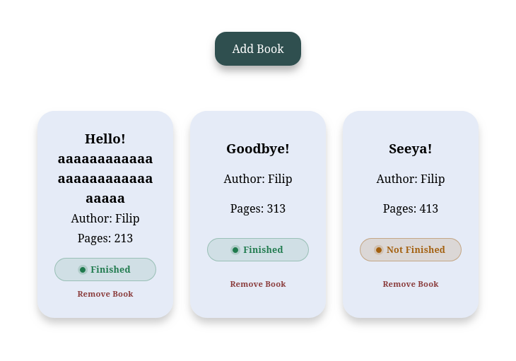

# Library

A small, responsive book library built with plain HTML, CSS, and JavaScript.



## About

Keep track of the books you own and whether you have finished them. The app starts with a few sample books, and you can add or remove titles at any time.

## Features

- Add a book with its title, author, page count, and reading status
- Remove books from the library
- Responsive card grid that wraps as the collection grows
- Colour-coded status pills for finished and unfinished books
- Collapsible "Add Book" form
- Keyboard-friendly focus styles and reduced-motion support

## Built with

- Semantic HTML
- CSS Grid, custom properties, and `color-mix()`
- Vanilla JavaScript: constructor functions, array methods, event delegation, and `FormData`

## Getting started

There are no dependencies or build steps.

Open `index.html` directly in your browser, or serve the project locally:

```bash
python3 -m http.server
```

Then visit [http://localhost:8000](http://localhost:8000).

## Project structure

```text
Library/
├── index.html
├── style.css
├── reset.css
├── script.js
├── screenshot.png
└── README.md
```

## How it works

- Books are stored in the `myLibrary` array.
- Each book is created with the `Book` constructor and receives a unique ID from `crypto.randomUUID()`.
- A single click listener on the book container handles every "Remove Book" button, including buttons created after a re-render.
- The add-book form uses `FormData` to read its fields and resets after a successful submission.

## Possible next steps

- Toggle a book's status directly from its card
- Persist the library in `localStorage`
- Add editing for book details
